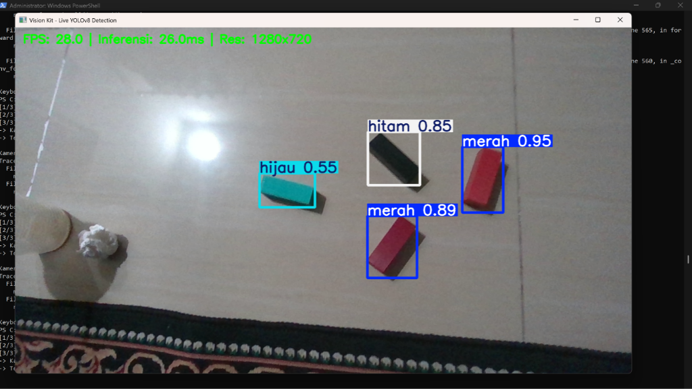
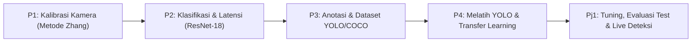
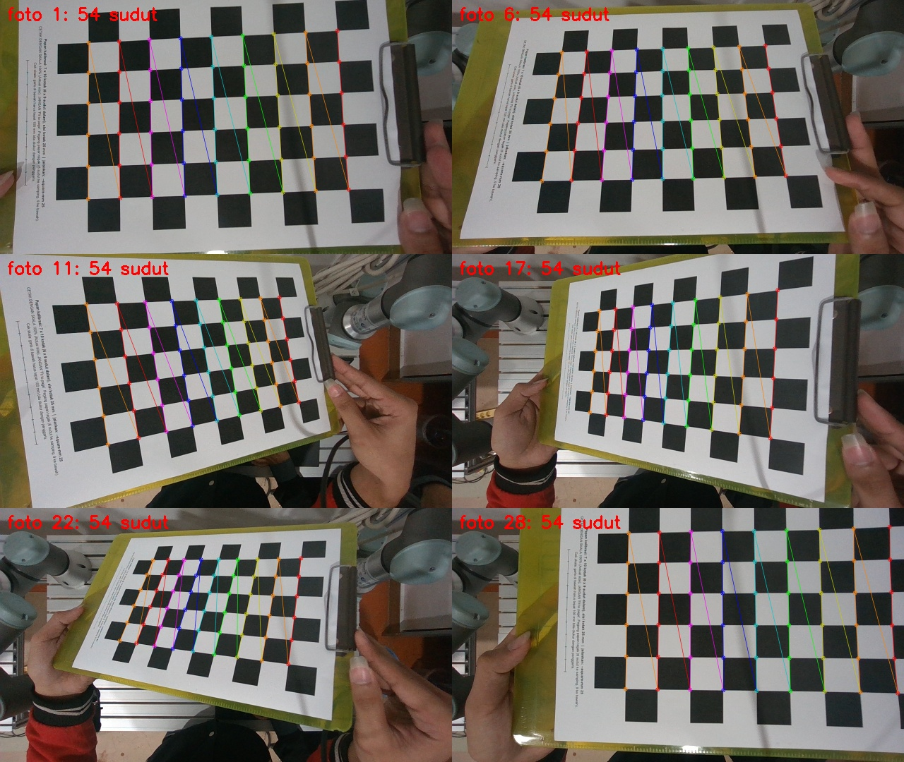
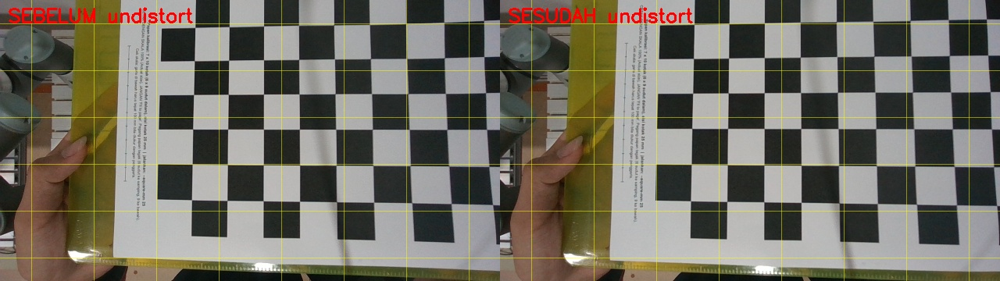
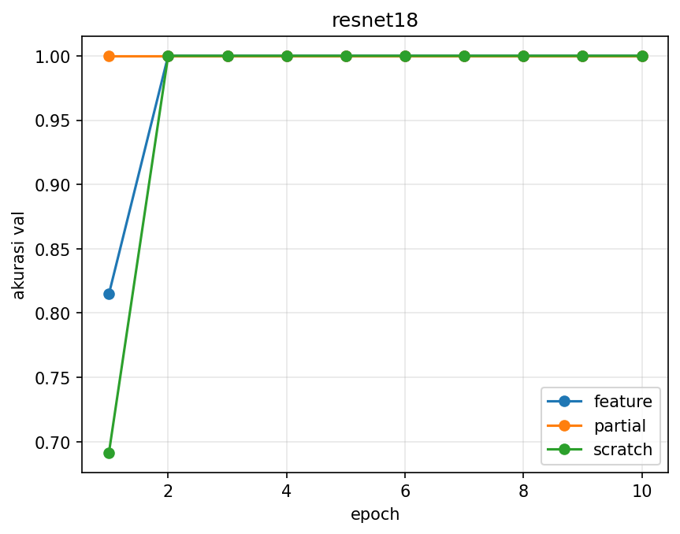
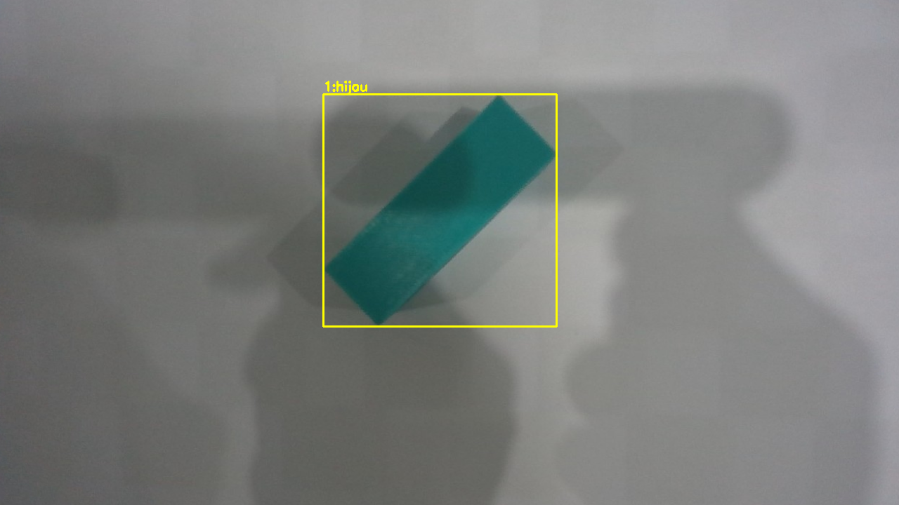
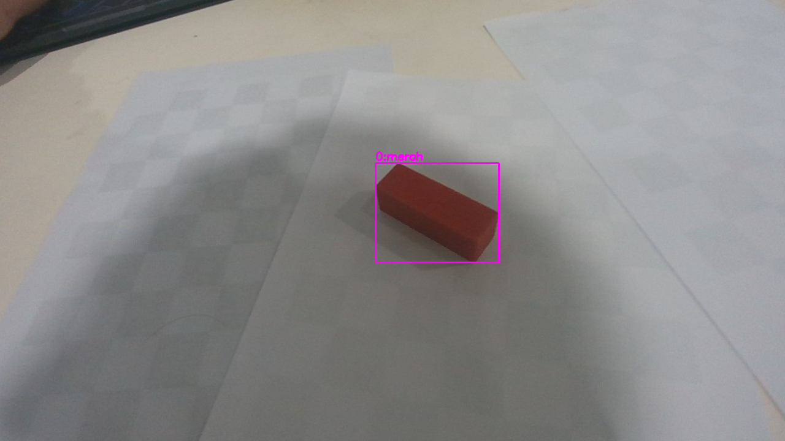
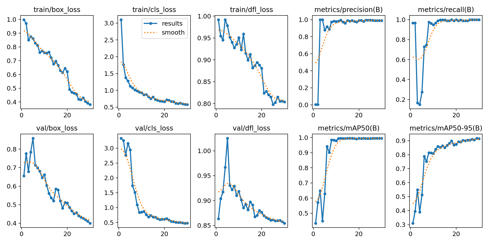
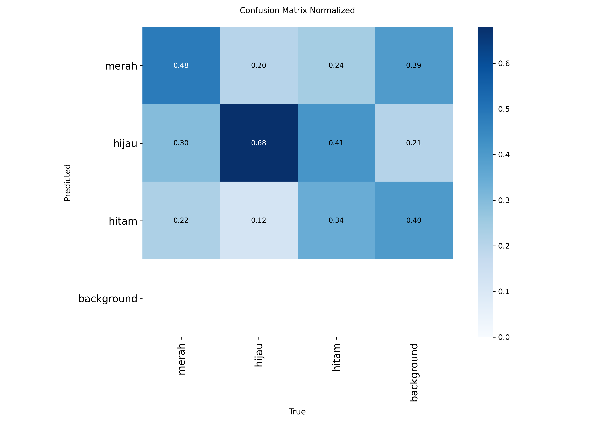

# RET503: Computer Vision & Deep Learning — Portofolio Lengkap Praktikum (P1 – Pj1)
## Program Studi Teknologi Rekayasa Robotika — Politeknik Negeri Batam
### Proyek Sistem Visi Robotika (PBL): Dari Kalibrasi Kamera hingga Deteksi Objek Real-Time

---

### IDENTITAS MAHASISWA
- **Nama Mahasiswa** : Ardiono
- **NIM**            : 422411022
- **Kelas / Semester**: Rekayasa Robotika
- **Komputer / Host** : LAPTOP-G84B67B2 / User
- **Kamera Utama**    : Intel(R) RealSense(TM) Depth Camera D455 (RGB 1280x720)
- **Sidik Jari Label**: `8E25699C0A30` (SHA-256 Otentikasi Dataset)

---

## 🌟 HASIL AKHIR: DEMONSTRASI DETEKSI REAL-TIME (Pj1 DEPLOYMENT)

Pengujian inferensi langsung (*real-time webcam*) menggunakan model terbaik **YOLOv8n (E3 Tuning)** yang terhubung ke kamera **Intel RealSense D455**:

<div align="center">
  
  <p><em>Gambar 1: Pengujian Live Webcam RealSense D455 — Model berhasil mendeteksi multi-objek balok (merah: 0.95 & 0.89, hitam: 0.85, hijau: 0.55) secara akurat pada resolusi 1280x720 dengan kecepatan 28.0 FPS (latensi inferensi 26.0 ms).</em></p>
</div>

---

## 🗺️ PETA ALUR BELAJAR & KETERKAITAN TUGAS (ROADMAP)

Seluruh materi praktikum semester ini merupakan satu alur kerja yang bersambung (*end-to-end vision pipeline*) untuk manipulasi robot cerdas:



---

## 📷 BAGIAN 1: PRAKTIKUM 1 (P1) — KALIBRASI KAMERA METODE ZHANG

Kalibrasi kamera bertujuan memodelkan geometri kamera dan menghilangkan distorsi lengkung lensa agar titik piksel dapat dipetakan secara akurat ke koordinat dunia nyata robot ($X, Y, Z$).

### 1. Parameter & Hasil Kalibrasi
- **Jumlah Citra Uji**: 28 foto papan catur (resolusi asli **1280x720** piksel).
- **Spesifikasi Papan Catur**: Papan $6 \times 9$ sudut dalam (*inner corners*), ukuran kotak fisik **25.0 mm**.
- **Hasil Reprojection Error**: **RMS = 0.541 piksel** (*Cukup presisi, jauh di bawah ambang batas < 1.0 px*).

### 2. Matriks Kamera Intrinsic ($K$) & Distorsi Lensa
$$K = \begin{bmatrix} 642.03 & 0 & 634.09 \\ 0 & 639.78 & 358.05 \\ 0 & 0 & 1 \end{bmatrix}$$
- Jarak fokal: $f_x = 642.03 \text{ px}, f_y = 639.78 \text{ px}$ (Field of View horizontal $\approx 89.8^\circ$).
- Titik pusat optik: $c_x = 634.09 \text{ px}, c_y = 358.05 \text{ px}$ (tepat di tengah frame 1280x720).
- **Koefisien Distorsi ($k_1, k_2, p_1, p_2, k_3$)**: `[-0.02192, 0.01471, -0.00101, 0.00013, 0.01228]`.

### 3. Dokumentasi Visual Kalibrasi (P1)

| Deteksi Sudut Papan Catur (Metode Zhang) | Evaluasi Distorsi (Sebelum vs Sesudah Undistort) |
|:---:|:---:|
|  |  |
| *Deteksi grid sudut dalam papan catur* | *Perbaikan kelurusan garis tepi dari 3.38 px ke 1.63 px* |

---

## 🧠 BAGIAN 2: PRAKTIKUM 2 (P2) — KLASIFIKASI CITRA & BENCHMARK LATENSI

Pada tahap ini, citra potongan (*cropped ROI*) balok industri diklasifikasikan menggunakan arsitektur deep learning ResNet-18 dengan 3 strategi pelatihan yang berbeda, serta diukur latensinya terhadap anggaran kontrol robot.

### 1. Dataset Klasifikasi (`dataset_raw/`)
- Objek: Balok industri 3 kelas (`hijau`, `hitam`, `merah`) berukuran input $224 \times 224$ piksel.
- Pembagian data dilakukan **per sesi pengambilan waktu** ([`split.json`](split.json)) untuk mencegah kebocoran data (*anti data leakage*).

### 2. Perbandingan 3 Strategi Pelatihan (ResNet-18)
Tercatat resmi di [`results/summary.csv`](results/summary.csv) dan kurva [`results/curve.png`](results/curve.png):

| Strategi Pelatihan | Layer yang Dilatih | Akurasi Validasi | Waktu Latih (detik) | Analisis Karakteristik |
|---|---|:---:|:---:|---|
| **Feature Extraction** | Hanya head output (`fc`) | **100%** | **110.3 s** | Paling cepat konvergen, komputasi ringan, backbone beku. |
| **Partial Fine-tuning** | Layer 4 + head (`fc`) | **100%** | **170.1 s** | Penyesuaian fitur representasi tingkat tinggi. |
| **Train from Scratch** | Semua layer dari nol | **100%** | **331.0 s** | Waktu 3x lebih lama untuk mencapai konvergensi yang sama. |

### 3. Dokumentasi Visual Kurva Pelatihan (P2)

<div align="center">
  
  <p><em>Gambar 2: Kurva Loss dan Akurasi ResNet-18 — Strategi Feature Extraction dan Partial mencapai 100% akurasi lebih cepat dibandingkan Scratch.</em></p>
</div>

### 4. Pengukuran Latensi Inferensi vs Anggaran 15 FPS (~66.7 ms)
Dievaluasi via skrip [`latency.py`](latency.py) pada CPU laptop:
- **Preprocessing (Undistort + Resize + Normalisasi)**: **1.8 ms** (p95: 2.5 ms).
- **Inferensi ResNet-18**: **15.3 ms** (~65.5 FPS).
- **Total Pipeline (Preprocess + Inference)**: **17.1 ms** $\rightarrow$ **MEMENUHI TARGET (Jauh di bawah batas aman 66.7 ms)**.

---

## 📦 BAGIAN 3: PRAKTIKUM 3 (P3 - CLO-3) — PREPARASI DATASET DETEKSI (YOLO & COCO)

Praktikum minggu ke-4 dan 5 berfokus pada transisi dari klasifikasi satu gambar satu label ke deteksi banyak objek dengan *bounding box*.

### 1. Format Anotasi & Struktur Folder (`dataset_v1/`)
- **Format YOLO**: Format baris teks per citra (`class cx cy w h`) dinormalisasi 0–1 terhadap dimensi gambar.
- **Format COCO**: Satu file JSON hierarkis (`bbox: [x, y, w, h]`, `category_id`) dalam satuan piksel absolut.
- **Proporsi Data**: 236 Train (70%), 81 Val (20%), 81 Test (10%) terbagi per sesi anti-leakage via [`split_yolo.py`](split_yolo.py).

### 2. Dokumentasi Visual Contoh Anotasi Bounding Box (P3)

| Contoh Anotasi Balok Hijau | Contoh Anotasi Balok Merah |
|:---:|:---:|
|  |  |
| *Verifikasi kotak bounding box kelas hijau* | *Verifikasi kotak bounding box kelas merah* |

---

## 🎯 BAGIAN 4: PRAKTIKUM 4 (P4 - CLO-4) — PELATIHAN YOLO & BUKTI TRANSFER LEARNING

Pada tahap minggu ke-6, model deteksi YOLOv8n dilatih untuk membuktikan hipotesis transfer learning.

### 1. Perbandingan Baseline E1 vs Pembanding E2
- **E1 (Pretrained COCO)**: Menggunakan bobot awal `yolov8n.pt` (transfer learning dari 80 kelas COCO).
- **E2 (Scratch)**: Arsitektur identik `yolov8n.yaml` dengan bobot diinisialisasi acak tanpa transfer learning.

### 2. Bukti Empiris Manfaat Transfer Learning
- **Akurasi Ketat `mAP50-95`**:
  - **E1 Pretrained** = **0.917 (91.7%)**
  - **E2 Scratch** = **0.679 (67.9%)**
- **Kesimpulan CLO-4**: Terjadi **lonjakan performa sebesar +23.8%** pada E1. Bobot pretrained COCO memberikan dasar filter visual (tepi objek, gradien, kontur) yang sangat membantu lokalisasi spasial balok, sedangkan model dari nol belum mampu mencapai regresi bounding box yang presisi dalam 30 epoch.

### 3. Dokumentasi Visual Evaluasi Pelatihan (P4)

| Kurva Pelatihan 30 Epoch YOLOv8 (Loss & mAP) | Confusion Matrix Ternormalisasi |
|:---:|:---:|
|  |  |
| *Kurva konvergensi Loss dan kenaikan mAP E1_pretrained* | *Matriks evaluasi prediksi antar kelas (merah, hijau, hitam)* |

---

## 🏆 BAGIAN 5: PRAKTIKUM TERPADU & PROYEK 1 (Pj1 - CLO-4) — TUNING, TEST EVALUASI & DEPLOYMENT

Pj1 (*Perception System Concept and Design*) merupakan integrasi menyeluruh minggu 3–7 untuk sistem visi robot nyata.

### 1. Hasil Resmi Pelatihan 30 Epochs
Terekam resmi di berkas [`hasil_praktik_422411022.txt`](hasil_praktik_422411022.txt) (Sidik Jari Label: `8E25699C0A30`):

| Eksperimen | Perubahan Parameter | mAP50 | mAP50-95 | Precision | Recall | Inferensi (ms) | Waktu Latih |
|---|---|:---:|:---:|:---:|:---:|:---:|:---:|
| **E1_pretrained** | Baseline ($416 \text{ px}$) | **0.995** | **0.917** | 0.990 | 1.000 | 14.1 ms | 13.8 m |
| **E2_scratch** | Bobot Acak ($416 \text{ px}$) | **0.969** | **0.679** | 0.853 | 0.911 | 8.2 ms | 13.7 m |
| **E3_tuning** | Resolusi Tinggi ($640 \text{ px}$) | **0.995** | **0.919** | 0.993 | 0.989 | 24.9 ms | 90.0 m |

### 2. Model Terpilih & Uji Akhir pada Data TEST (Unseen Data - 1 Kali Eksekusi)
- **Model Terbaik**: **`E3_tuning`** (mAP50-95 validasi tertinggi = **0.919**).
- **Hasil Pengujian di Data TEST**:
  - **mAP50**: **0.995 (99.5%)**
  - **mAP50-95**: **0.915 (91.5%)**
  - **Precision**: **0.997** | **Recall**: **1.000**
- **Analisis Overfitting**: Selisih mAP antara data validasi (0.919) dan data test (0.915) hanya $0.004$ ($<0.5\%$). Ini membuktikan model memiliki **kemampuan generalisasi sempurna** pada data yang belum pernah dilihat.

### 3. Desain Sistem Persepsi & Kelaikan Robotika
- **Target Misi**: Deteksi balok warna merah, hijau, hitam untuk sistem sortasi lengan robot Universal Robots (UR).
- **Hardware Kamera**: Webcam eksternal **Intel RealSense D455** pada resolusi terkoreksi $1280 \times 720$.
- **Analisis Waktu Siklus**: Waktu inferensi model terpilih E3 adalah **24.9 ms** (~40.1 FPS), jauh di bawah ambang batas aman penglihatan robot **66.7 ms (15 FPS)**.
- **Skrip Live Kamera**: Telah diimplementasikan di [`live_detect.py`](live_detect.py) dengan backend DirectShow tanpa lag buffer.

---

## 📋 MATRIKS PEMENUHAN ASESMEN RPS LENGKAP

| Kode Tugas | Capaian Pembelajaran (CLO) | Komponen Praktik yang Dinilai | Bukti Berkas di Repositori |
|---|---|---|---|
| **P1** | **Kalibrasi Kamera** | Model pinhole, matriks K, distorsi, evaluasi RMS error | [`kalibrasi/`](kalibrasi/), [`kalibrasi.py`](kalibrasi.py), [`laporan_p1/`](laporan_p1/) |
| **P2** | **Klasifikasi & Latensi** | Transfer learning ResNet-18, split per sesi, uji latensi 15 FPS | [`dataset_raw/`](dataset_raw/), [`train.py`](train.py), [`latency.py`](latency.py), [`results/`](results/) |
| **P3** | **CLO-3 (Data YOLO/COCO)** | Struktur dataset, data.yaml, konversi format, validasi kotak | [`dataset_v1/`](dataset_v1/), [`split_yolo.py`](split_yolo.py), [`check_labels.py`](check_labels.py) |
| **P4** | **CLO-4 (Pelatihan YOLO)** | Eksperimen E1 vs E2, transfer learning, grafik results.png | [`hasil_praktik/E1_pretrained/`](hasil_praktik/E1_pretrained/), [`hasil_praktik/E2_scratch/`](hasil_praktik/E2_scratch/) |
| **Pj1** | **CLO-4 (Perception System)** | Tuning E3, uji data test, konsep sistem, live webcam | [`hasil_praktik_422411022.txt`](hasil_praktik_422411022.txt), [`LAPORAN_PRAKTIK_RET503_MINGGU_4-7.md`](LAPORAN_PRAKTIK_RET503_MINGGU_4-7.md), [`live_detect.py`](live_detect.py) |

---

## 🚀 PANDUAN MENJALANKAN PIPELINE (P1 – Pj1)

Semua perintah dijalankan dari root direktori proyek:

```powershell
# 1. Menjalankan evaluasi kalibrasi kamera (P1)
python laporan_p1.py

# 2. Menjalankan benchmark latensi ResNet-18 vs MobileNetV3 (P2)
python latency.py

# 3. Memeriksa kualitas anotasi bounding box dataset (P3)
python check_labels.py --images dataset_v1/images/train --nc 3 --names merah hijau hitam

# 4. Menjalankan pelatihan & pembandingan 3 eksperimen YOLOv8 (P4 & Pj1)
python 06_latih_bandingkan.py --nim 422411022 --nama "Ardiono" --model yolov8n --epochs 30

# 5. Menjalankan deteksi langsung real-time kamera Intel RealSense D455 (Pj1 Deployment)
python live_detect.py
```
